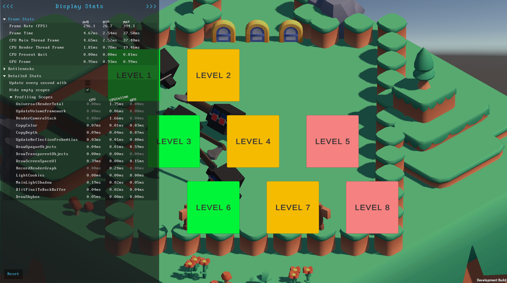
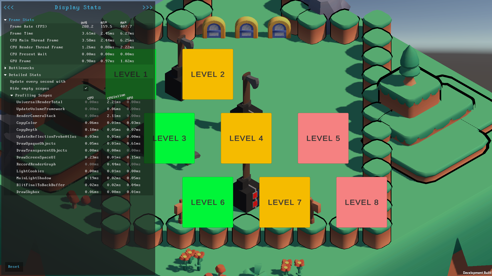
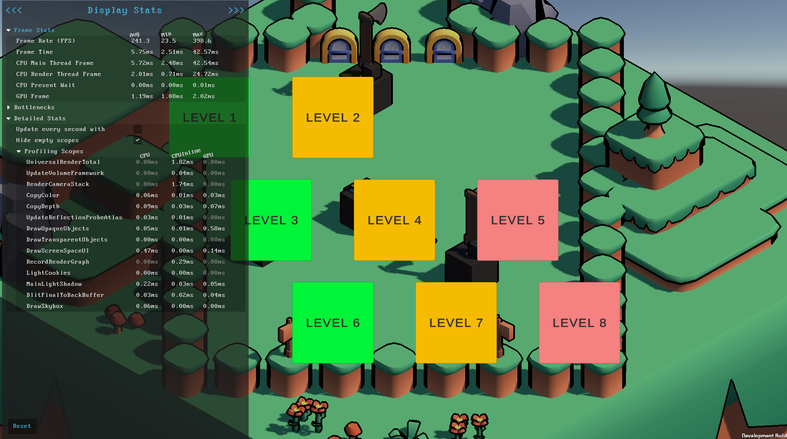
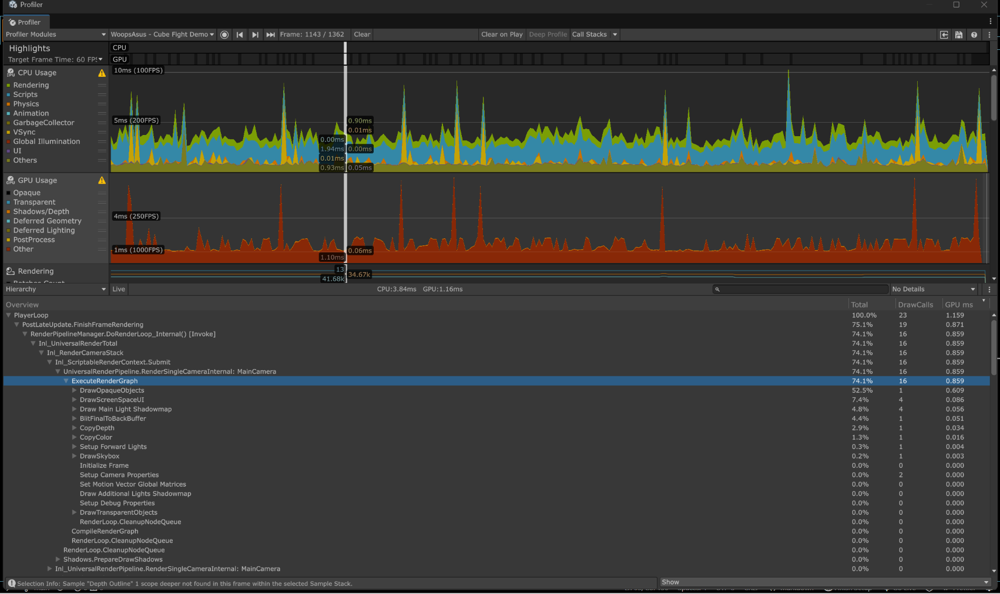
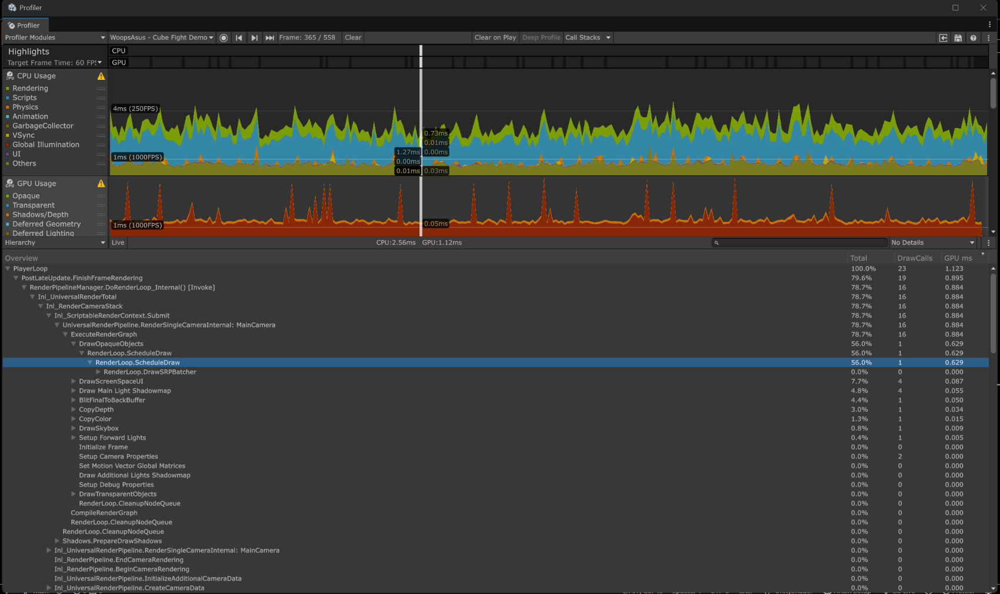
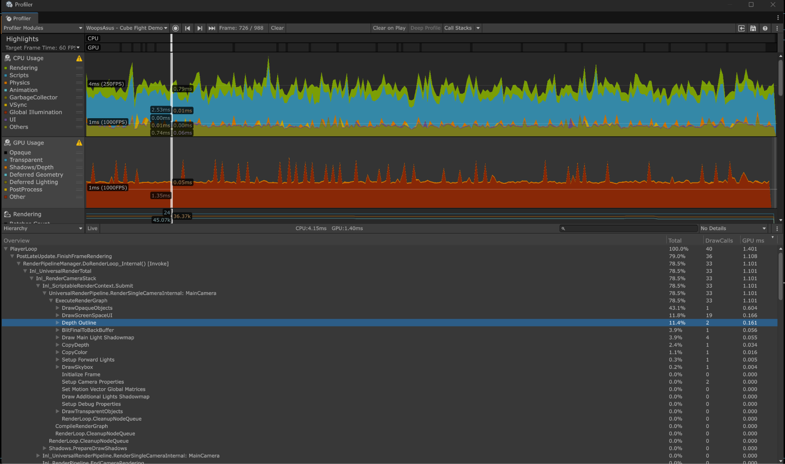

# Outline Rendering Techniques — GPU Performance Comparison

## 1. Objective

This experiment explores and compares two outline rendering techniques implemented in **Unity 6.2 with Universal Render Pipeline (URP 17.2)**:

1. **Inverted Hull Outline** — Geometry-based rendering
2. **Screen-space Depth Outline** — Depth-based edge detection

The objectives are to:

- Understand the rendering principles behind each technique.
- Implement custom shaders using HLSL.
- Compare their visual characteristics and limitations.
- Measure their GPU performance using Unity Profiler and Rendering Debugger.
- Investigate the trade-offs between geometry processing and screen-space processing.

---

## 2. Implementation

### 2.1 Inverted Hull Outline

The Inverted Hull technique creates an outline by rendering an enlarged version of the original mesh.

The vertex shader scales each vertex position in object space:

```hlsl
float3 expandedPosition =
    IN.positionOS.xyz * _OutlineScale;

OUT.positionCS =
    TransformObjectToHClip(expandedPosition);
```

The outline pass uses the following rendering states:

```hlsl
Cull Front
ZWrite Off
ZTest LEqual
```

**Rendering principle:**

1. The original mesh is rendered normally.
2. An enlarged version of the mesh is rendered using the outline material.
3. Front-facing triangles of the enlarged mesh are culled.
4. Depth testing prevents most of the enlarged mesh from appearing over the original surface.
5. The remaining visible portions form the outline around the silhouette.

**Advantages:**

- Relatively simple shader implementation.
- Does not require sampling the camera depth texture.
- Primarily operates on the geometry of selected objects.
- Can produce silhouette outlines without detecting scene-wide depth discontinuities.

**Limitations:**

- Requires additional mesh rendering.
- Rendering cost can increase with object count and mesh complexity.
- Scaling vertices around the object origin can produce inconsistent outline thickness.
- Irregular geometry may cause protruding or disconnected outlines.
- Uniform object-space scaling does not guarantee constant screen-space line width.

### 2.2 Screen-space Depth Outline

The screen-space technique detects edges using depth differences between neighbouring pixels.

It is implemented as a **URP Full Screen Pass Renderer Feature**, rather than as a material on individual scene objects.

The fragment shader samples the camera depth texture at the current screen UV and four neighbouring locations.

```hlsl
float center = GetDepth(uv);

float left  = GetDepth(uv - float2(offset.x, 0));
float right = GetDepth(uv + float2(offset.x, 0));
float up    = GetDepth(uv + float2(0, offset.y));
float down  = GetDepth(uv - float2(0, offset.y));
```

The maximum absolute depth difference is calculated:

```hlsl
float difference = max(
    max(abs(center - left), abs(center - right)),
    max(abs(center - up), abs(center - down))
);
```

The difference is normalized relative to the centre depth and compared against a configurable threshold:

```hlsl
float relativeDifference =
    difference / max(center, 1.0);

float edge = step(
    _DepthThreshold,
    relativeDifference
);
```

Finally, the edge mask is used to composite the outline colour over the original scene colour:

```hlsl
half3 finalColor = lerp(
    sceneColor.rgb,
    _OutlineColor.rgb,
    edge * _OutlineColor.a
);
```

**Rendering principle:**

1. The scene is rendered normally.
2. The Full Screen Pass accesses the camera depth texture.
3. Each screen pixel is compared with neighbouring depth samples.
4. Pixels with sufficiently large depth discontinuities are classified as edges.
5. The detected edges are composited over the scene colour.

**Advantages:**

- Does not require additional outline mesh objects.
- Does not need to expand or modify scene geometry.
- Can apply a consistent outlining effect across the rendered scene.
- Outline sampling distance can be defined in screen pixels.
- Avoids geometry extrusion artifacts caused by mesh normals or pivots.

**Limitations:**

- Processes the entire screen, including areas without objects.
- Rendering cost depends on resolution and texture sampling.
- May require depth texture preparation or copying.
- Cannot reliably detect edges without sufficient depth discontinuity.
- May miss internal geometric edges where adjacent surfaces have similar depths.
- Does not inherently distinguish individual objects.
- Increasing the sampling distance does not necessarily produce perfectly uniform line thickness.

---

## 3. Visual Comparison

### 3.1 Baseline — No Outline

The original scene is rendered without either outline technique.



### 3.2 Inverted Hull Outline

The outline is produced by rendering an expanded mesh with front-face culling.



### 3.3 Screen-space Depth Outline

The outline is generated by detecting depth discontinuities in the camera depth texture.



### 3.4 Visual Observations

**Inverted Hull:**

- Produces silhouette outlines around the geometry using an enlarged mesh.
- Some irregular mesh shapes can result in inconsistent line thickness.
- The visual result depends on mesh geometry, pivot placement, and expansion technique.

**Screen-space Depth Outline:**

- Produces outlines around visible depth discontinuities.
- Can outline multiple scene objects without adding individual outline renderers.
- May detect additional geometric boundaries that are not equivalent to the silhouettes produced by Inverted Hull.
- Some boundaries remain undetected when the depth difference is insufficient.

The two techniques do not produce identical images. Visual quality must therefore be considered alongside performance.

---

## 4. Benchmark Setup

### Environment

| Setting            | Configuration                      |
| ------------------ | ---------------------------------- |
| Engine             | Unity 6.2                          |
| Rendering Pipeline | Universal Render Pipeline 17.2     |
| Platform           | Windows Standalone                 |
| Build Type         | Development Build                  |
| GPU Profiling      | Unity GPU Profiler                 |
| Average GPU Timing | URP Rendering Debugger             |
| Scene              | Cube Fight — Level Selection Scene |
| SSAO               | Disabled                           |

### Benchmark Configurations

Three configurations were tested:

| Configuration      | Inverted Hull | Depth Outline | SSAO |
| ------------------ | ------------- | ------------- | ---- |
| Baseline           | Off           | Off           | Off  |
| Inverted Hull      | On            | Off           | Off  |
| Screen-space Depth | Off           | On            | Off  |

The tests aimed to isolate the additional GPU workload introduced by each outline technique.

GPU frame averages were recorded using the URP Rendering Debugger. Selected frames were also inspected through Unity GPU Profiler to identify rendering passes and GPU timing.

---

## 5. GPU Performance Results

### 5.1 Average GPU Frame Time

| Technique                  | Average GPU Frame Time | Increase vs Baseline |
| -------------------------- | ---------------------: | -------------------: |
| Baseline                   |                0.95 ms |                    — |
| Inverted Hull              |                0.98 ms |             +0.03 ms |
| Screen-space Depth Outline |                1.19 ms |             +0.24 ms |

The incremental GPU cost is calculated as:

**Incremental GPU Time = GPU Time with Effect − Baseline GPU Time**

For Inverted Hull:

0.98 − 0.95 = **0.03 ms**

For Screen-space Depth Outline:

1.19 − 0.95 = **0.24 ms**

In these measurements, Inverted Hull showed a lower incremental GPU frame time.

However, these results represent preliminary measurements from short sampling windows. The small Inverted Hull delta requires repeated measurements before drawing a strong performance conclusion.

### 5.2 Baseline Profiler Evidence

The baseline build had neither outline technique enabled.



This configuration provides a reference for measuring the additional workload introduced by the outlining techniques.

### 5.3 Inverted Hull Profiler Evidence

The Inverted Hull technique adds geometry rendering work to the scene.



Unlike the Full Screen Pass, the outline rendering work may be incorporated into the normal opaque geometry rendering stage.

Consequently, the cost of Inverted Hull should be evaluated using the change in total GPU frame time, geometry statistics, and rendering workload rather than assuming it will appear under a separate profiler marker.

### 5.4 Screen-space Depth Outline Profiler Evidence

The Screen-space Depth Outline uses an additional URP Full Screen Pass.



In the selected profiler frame:

- Total GPU Frame Time: approximately **1.401 ms**
- Depth Outline Render Pass: approximately **0.161 ms**
- Depth Outline: **2 Draw Calls** within the identified pass

The 0.161 ms value represents the GPU cost attributed to the named outline pass in that particular frame.

It is not directly equivalent to the 0.24 ms difference between the average GPU frame times, because the full effect may involve additional rendering operations, and the measurements come from different sampling windows.

### 5.5 Draw Call Observations

Selected profiler frames reported:

| Configuration              | Draw Calls |
| -------------------------- | ---------: |
| Baseline                   |         23 |
| Inverted Hull              |         23 |
| Screen-space Depth Outline |         40 |

These are frame-specific observations, not average Draw Call counts.

The Screen-space Depth configuration also showed differences in screen-space UI draw calls. Therefore, the difference in total Draw Calls cannot be attributed exclusively to the outline technique.

Furthermore, Draw Call counts alone do not determine GPU performance. Geometry processing, fragment processing, texture sampling, blending, and memory operations must also be considered.

---

## 6. Performance Analysis

### 6.1 Inverted Hull Cost Model

The additional rendering cost of Inverted Hull can be approximated as:

**T_Hull ≈ T_DrawSubmission + T_VertexProcessing + T_RasterizationAndFragmentProcessing**

Important factors include:

- Number of outlined objects
- Vertex and triangle counts
- Additional rendering submissions
- Batching and instancing opportunities
- Number of pixels covered by the enlarged geometry
- Depth testing and fragment rejection

Its performance is therefore expected to depend strongly on scene geometry and object count.

### 6.2 Screen-space Cost Model

The Screen-space Depth Outline cost can be approximated as:

**T_Screen ≈ T_DepthPreparation + T_FullScreenPass + T_Compositing**

The implementation performs approximately:

- Five depth texture samples per screen pixel
- One scene colour texture sample per screen pixel
- Several depth conversions and arithmetic operations

At 1920 × 1080 resolution:

1920 × 1080 = **2,073,600 pixels**

With six texture sampling operations per pixel:

2,073,600 × 6 = **12,441,600 shader-level texture sample operations per frame**

This is a theoretical count based on shader instructions, not a measurement of physical GPU memory reads. Texture caching, hardware execution, and compiler optimizations affect the actual cost.

Screen-space outlining is therefore expected to scale primarily with rendering resolution and the complexity of its pixel-processing algorithm.

### 6.3 Expected Scaling Behaviour

| Scenario                       | Inverted Hull                                       | Screen-space Depth Outline                                           |
| ------------------------------ | --------------------------------------------------- | -------------------------------------------------------------------- |
| Increasing object count        | Additional geometry and submissions may increase    | Full-screen pass cost remains relatively independent of object count |
| Increasing mesh complexity     | Additional vertex processing increases              | Full-screen pass geometry remains minimal                            |
| Increasing resolution          | Rasterization and fragment cost may increase        | Full-screen texture sampling cost increases                          |
| Simple scene with few meshes   | May have low overhead                               | Still processes the screen                                           |
| Complex scene with many meshes | Additional geometry processing may become expensive | May become comparatively more attractive                             |
| Irregular low-poly meshes      | Geometry artifacts may occur                        | Avoids geometry expansion artifacts                                  |

These are theoretical expectations, not results demonstrated by the current benchmark.

---

## 7. Benchmark Limitations

Several factors limit the interpretation of the results.

### 7.1 Short Measurement Windows

The averages were obtained from short Rendering Debugger sampling windows rather than multiple long benchmark runs.

The measured differences, particularly the 0.03 ms Inverted Hull increment, should be verified through repeated testing.

### 7.2 Different Rendering Workload Details

Selected GPU Profiler frames showed differences in total Draw Calls and UI rendering activity.

Therefore, not every measured difference can be confidently attributed to the outline algorithm alone.

### 7.3 Hardware and Resolution Scaling

The experiment has not established how either technique performs across:

- Different GPUs
- Different screen resolutions
- Different object counts
- Higher-polygon meshes
- More complex levels

### 7.4 Visual Equivalence

The methods detect different types of edges:

- Inverted Hull is based on expanded mesh silhouettes.
- Screen-space Depth Outline is based on visible depth discontinuities.

Their outputs are not visually identical, making this a comparison of practical rendering approaches rather than two equivalent implementations of the same image.

---

## 8. Conclusion

Two outline rendering techniques were successfully implemented using custom HLSL shaders and Unity URP.

The experiment covered:

- Vertex transformations
- ShaderLab rendering states
- Front-face culling
- Depth testing and depth writes
- Camera depth texture sampling
- Full-screen rendering
- Screen-space edge detection
- URP Renderer Features
- GPU performance profiling

In the captured measurements:

- Baseline GPU average: **0.95 ms**
- Inverted Hull GPU average: **0.98 ms**
- Screen-space Depth Outline GPU average: **1.19 ms**

Inverted Hull showed a lower measured incremental GPU cost in this particular test scene.

However, the benchmark results are preliminary and do not establish that Inverted Hull is universally faster.

The experiment demonstrates that choosing a rendering technique requires evaluating both **performance characteristics and visual requirements**, rather than relying only on theoretical complexity or Draw Call counts.

## 9. Potential Future Work

Possible extensions include:

- Benchmarking across multiple rendering resolutions
- Testing higher object counts and more complex meshes
- Adding normal-based edge detection
- Improving outline thickness consistency
- Evaluating object-specific screen-space masks
- Collecting longer GPU timing samples and comparing medians
- Investigating batching and instancing for geometry-based outlines

These extensions are outside the scope of the current experiment.
